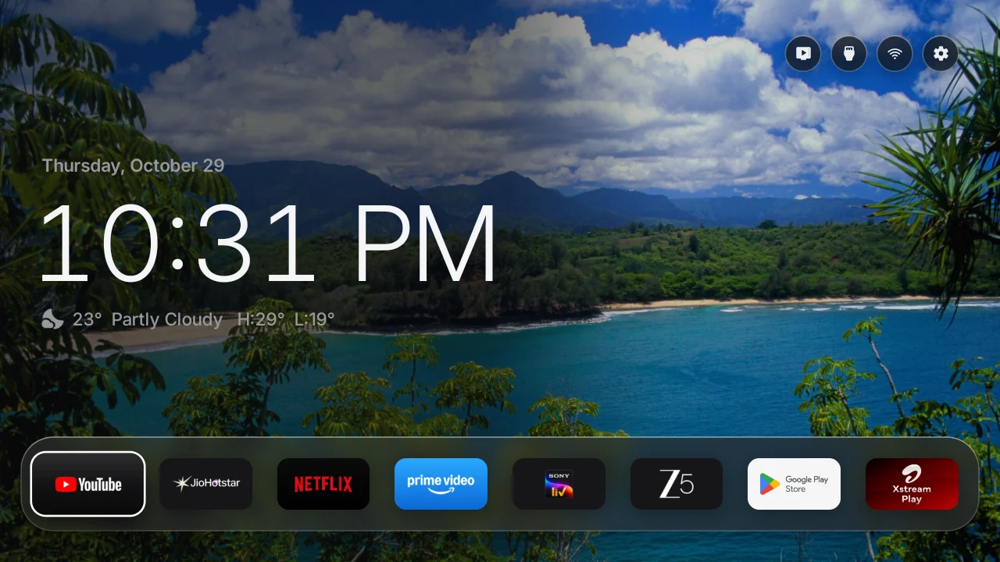
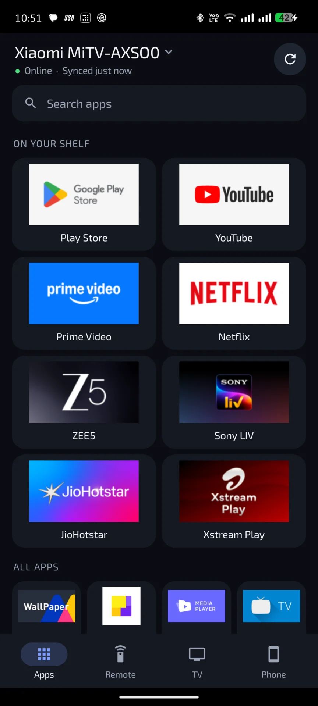

<div align="center">


# Free My TV

**A fast, ad-free home screen for Google TV, LG and Samsung TVs.**

Trending picks from your own apps, the weather at a glance, and a look that follows the sunset.<br>
Open source. Built with Claude Code. One button to undo.

[**freemytv.io**](https://freemytv.io) · [Install](#install) · [LG TVs](#lg-tvs-webos) · [Samsung TVs](#samsung-tvs-tizen) · [Phone app](#phone-app) · [Any TV](#any-tv) · [Make it yours](#make-it-yours)



<br>



</div>

## What you get

- **No ads.** No sponsored rows, banners or autoplaying promos. Not one.
- **Your apps, front and center.** The streaming apps you actually use, on a glass shelf. Pick them and their order right on the TV.
- **Trending, not sponsored.** Fresh picks every hour (3 to 8, your choice) from what's trending this week and the latest releases, only from apps you already have. One wide hero card in the middle, with the one before it and the one after it showing at the sides; it slides by itself, and Movies and Shows get their own tabs. Not interested? Turn the **Hero section** off: nothing is asked of TMDB any more, and your own photos become the home screen's full-screen wallpaper.
- **Weather and markets, one press away.** The hour-by-hour forecast, sunrise and sunset, and live crypto prices.
- **Light by day, dark by night.** It follows your city's real sunset, the way your phone does.
- **A screensaver to match.** Full-screen photos of the picks with a big glass clock.
- **Your own photos** (Google TV and Android TV). Send them from your computer or pick them in the phone app (up to 100): the screensaver shows them, and they are the home screen's wallpaper (three of your choice, taking turns, when the hero is off).
- **A phone app.** [Free My TV Remote](#phone-app) (Android) is a remote, the TV's apps and settings, photos, and *Share to TV*, for one TV or several, over your home Wi-Fi.
- **Fast.** 60 fps, every frame in 16.6 ms, on the TV's own chip. The home screen uses 96 MB of memory instead of 242 MB (−60%).<br><sub>Measured on a 98″ TCL Google TV running Android 14.</sub>
- **Set up on the TV.** Language, your city, temperature, theme, the weather and prices cards, which coins, the hero section, the apps on the shelf and the round buttons at the top (Live TV, HDMI inputs, **Wi-Fi**, settings), in Free My TV's own settings. The app you're on is marked with a white border.
- **Safe.** No root. Nothing is uninstalled. One button brings back the factory home screen.

## Install

About ten minutes. You need a Google TV or Android TV (Android 8 or newer) and a computer on the same Wi-Fi.

### The easy way: an AI assistant

1. **On the TV**, turn on developer mode: Settings → System → About → press *Android TV OS build* 7 times. Then Settings → System → Developer options → turn on **USB debugging**. Write down the TV's IP address (Settings → Network & Internet).
2. **On your computer**, open an AI coding assistant ([Claude Code](https://claude.com/claude-code), Codex or Antigravity) and say:
   > Install Free My TV (github.com/simbasjungles/free-my-tv) on my TV at 192.168.1.50. I live in Lisbon.

   It downloads the code, installs the tools it needs, builds the app and puts it on your TV, and asks before anything important. Swap in your TV's IP and your city.
3. **On the TV**, open *Free My TV* → *Home Screen* → *Free My TV*. That's when the TV asks *Allow USB debugging?* for Free My TV: tick *Always allow* and accept.

### The manual way

1. **On the TV**, do step 1 above.
2. **Tools:** a JDK (17+), the Android SDK command-line tools (build-tools 34, platform android-34) and adb. On a Mac:
   ```bash
   brew install --cask temurin android-commandlinetools android-platform-tools
   sdkmanager "build-tools;34.0.0" "platforms;android-34"
   ```
   On Linux, get OpenJDK 17, Android's command-line tools and adb from your package manager, then run the same `sdkmanager` line. On Windows, use Git Bash (which Claude Code uses there) or WSL.
3. **Build:**
   ```bash
   ./build.sh
   ```
   The first run creates `config.properties`. Set your city and your [TMDB key](#the-tmdb-key) there, then run it again.
4. **Install:**
   ```bash
   adb connect 192.168.1.50:5555
   adb install -r FreeMyTV.apk
   ```
   If the install seems stuck, look at the TV: on Android 14, Google Play Protect may hold it with *Risky app blocked* ("built for an older version of Android"), since Free My TV targets Android 13. Choose *More details* → *Install anyway*. Updates don't ask again.

   Chromecast with Google TV on Android 14 keeps port 5555 closed even with USB debugging on: turn on *Wireless debugging* (Developer options), pair with `adb pair <address:port> <code>`, then run `adb tcpip 5555` over that connection. Port 5555 closes again at every restart, so after one, *Original*, the watchdog and the boot check can't reach ADB until you run `adb tcpip 5555` again (the pairing stays).

   On TCL TVs, also let it run in the background (TCL blocks it by default, and the switch never starts):
   ```bash
   adb shell "appops set io.freemytv AUTO_START allow || appops set io.freemytv APP_AUTO_START allow"
   ```
5. **On the TV**, open *Free My TV* → *Home Screen* → *Free My TV*. The TV asks *Allow USB debugging?* once more, now for Free My TV itself: tick *Always allow* and accept. (Run `adb disconnect 192.168.1.50:5555` first: on Android 8 to 10 the TV can hand that answer to a computer that's still connected.)

## LG TVs (webOS)

The same home screen as an LG app: the picks, the glass shelf with your apps, the drawer with inputs, weather and prices, day and night, Home Settings and the shelf editor. It installs through LG's own Developer Mode, with nothing rooted or changed on the TV. LG's home screen stays where it is, and Free My TV is one press of a number key away (or in LG's app list, on remotes without them).

You need an LG TV (webOS 3 or newer) and a computer on the same Wi-Fi, with Python 3.

1. **On the TV**, open the LG Content Store and install **Developer Mode**. Sign in with a free [LG developer account](https://webostv.developer.lge.com), turn on **Dev Mode Status** (the TV restarts), then turn on **Key Server**. Write down the IP address and the passphrase it shows.
2. **On your computer**, get the code and build. `config.properties` works as for Google TV (your city, your [TMDB key](#the-tmdb-key)):
   ```bash
   git clone https://github.com/simbasjungles/free-my-tv && cd free-my-tv
   python3 webos/build.py
   ```
3. **Install.** The first time, it asks for the TV's passphrase; updates don't:
   ```bash
   python3 webos/install.py 192.168.1.50
   ```
4. **On the TV**, while Free My TV is open, hold a number key on the remote. From then on, that key opens it from anywhere. On a remote without number keys, open it from LG's app list on the home screen, like any other app.

With an AI assistant, say *"Install Free My TV (github.com/simbasjungles/free-my-tv) on my LG TV at 192.168.1.50. I live in Lisbon."* It builds the app and hands you the install command, so you type the passphrase yourself.

With the [webOS Homebrew Channel](https://github.com/webosbrew/webos-homebrew-channel), you can skip the computer: add the repository `https://freemytv.io/webos/apps.json` in the Channel's settings, and Free My TV shows up in its list. That's the release build: it takes the city from the TV's time zone, and the picks need your own build with a [TMDB key](#the-tmdb-key). If you installed your own build, don't update it from there, or the release replaces it.

On webOS 6 and newer, LG doesn't let apps installed through Developer Mode see which apps the TV has. Free My TV then shows the well-known ones it finds (Netflix, YouTube, Prime Video, Disney+, Apple TV, Plex and more) and asks the TV, once, for the access LG's phone app uses: a message on the TV asks whether to allow Free My TV. Allow it, and from the next start all your apps show, with their icons.

Developer Mode lasts about 40 days: open the Developer Mode app now and then and press **EXTEND**. To remove Free My TV, run `python3 webos/install.py 192.168.1.50 --uninstall`.

## Samsung TVs (Tizen)

The same home screen as a Samsung app, with everything the LG one has: the picks, the shelf, the drawer with the inputs, the weather and the prices, day and night, and its own settings. It installs through Samsung's own Developer Mode, with nothing rooted or changed on the TV, and Samsung's home screen stays where it is.

You need a Samsung TV from 2017 or newer (Tizen 3+) and a computer on the same Wi-Fi. (2015 and 2016 models, on Orsay or Tizen 2, can't run it; a Google TV streamer on HDMI can.)

1. **On the TV**, open **Apps** and type `1 2 3 4 5` on the remote. Turn **Developer mode** on, type your computer's IP address in **Host PC IP**, and restart the TV.
2. **On your computer**, download [TizenBrew Installer](https://github.com/reisxd/TizenBrewInstaller/releases/latest), the community's installer for Samsung TVs, open it and connect to your TV.
3. **Install from GitHub:** type `simbasjungles/free-my-tv`. On 2023 and newer TVs it asks you to sign in to your Samsung account once, to sign the app for your TV.
4. **Straight to it:** in the TV's settings, under Start Screen Options, turn on **Autorun Last App**: the TV turns on into Free My TV.

This build takes your city from the TV's time zone. For your exact city and the trending picks, build it with your own `config.properties` and [TMDB key](#the-tmdb-key): open the folder in Claude Code and say *"Install Free My TV on my Samsung TV at 192.168.1.50. I live in Lisbon."* It sets up Samsung's tools, and on 2023 and newer TVs you sign in to your Samsung account in the browser to make the certificate. Your signed build installs with `python3 tizen/install.py 192.168.1.50`, which needs only Python: no Tizen Studio, and no Rosetta on Apple Silicon Macs.

## Phone app

**Free My TV Remote** is an Android phone app (Android 8 or newer) for a TV that runs Free My TV on Google TV or Android TV. It talks to the TV over your home Wi-Fi only: nothing goes through the internet, and there is no account.

- **Apps.** The TV's apps with their icons, the shelf first, with search. Tap one and it opens on the TV.
- **Remote.** A round pad, Back, Home, Menu, volume and playback, with a small buzz on every key. The phone's volume buttons change the TV's volume while the Remote tab is open. Keys reach the TV in milliseconds (the first one after the TV has been idle takes a few seconds, while a small helper starts).
- **TV settings.** All of *Home Settings* from the phone: language, temperature, theme, the weather and date widgets, a city search, the coins, the hero section, the shelf, the top buttons and the remote's buttons.
- **Photos.** Add pictures from the phone's gallery (each one is turned upright, cut to 16:9 and sent), and select and delete the ones on the TV. Choose the three **Wallpapers** that take turns on the home screen when the hero is off.
- **Share to TV.** Share a link from any app (a YouTube video, a web page) and pick *Open on TV*.
- **Several TVs.** Pair as many TVs as you like, give each a name, and switch from the TV's name at the top. Each has its own apps, settings and icons.
- **Its own copy.** The phone keeps a copy of the TV's apps and settings and asks the TV again only when you tap **Refresh**. A change made while the TV is off waits on the phone and goes when the TV is back.
- **Its own settings** (*Phone* tab): vibration, the volume buttons, keeping the screen on, the grid's columns, the tab it opens on and refreshing when it opens.

### Install the phone app

1. **Build it** like the TV app (the same tools; Git Bash on Windows). It makes `FreeMyTV-Remote.apk`, signed with the same `freemytv.keystore`:
   ```bash
   ./companion/build.sh
   ```
2. **Install it** on the phone: turn on USB debugging on the phone and run `adb install -r FreeMyTV-Remote.apk`, or copy the file to the phone and open it (allow *Install unknown apps* for the app you open it from; if Play Protect asks, choose *Install anyway*).
3. **Pair it.** Make sure Free My TV is running on the TV (open it once). Open the phone app: it finds the TV by itself (or tap *Enter the TV's address*). Tap the TV, and type the **6-digit code** the TV shows on its screen for two minutes.

The phone and the TV must be on the same Wi-Fi. Some routers keep devices on different bands of the same network (2.4 and 5 GHz) apart, and the phone then says it can't reach the TV (*No route to host*): put both on the same band, or turn off the router's *AP isolation* / *client isolation*.

**How it stays safe.** The TV runs a small server on your home network (port 8765) and serves only home-network addresses. Pairing agrees a secret key between the phone and the TV and proves the code with it, so the code and the token are never sent and someone listening to your Wi-Fi learns nothing; a new code can be asked for every 5 seconds at most, with 5 tries each and a pause that grows after wrong ones, and up to 8 phones can be paired. After that, every request from the phone and every reply from the TV is signed, and a request can't be sent twice, so nobody else on your Wi-Fi can control the TV or pass off another device as it. The traffic itself isn't encrypted (plain HTTP): someone who can watch your Wi-Fi could read your app list and settings, but not control anything. *Forget this TV* in the app also removes the phone on the TV.

## Settings

The first values come from `config.properties`, created by the first build (Google TV, LG and Samsung use the same file). Most of them can also be changed on the TV, in *Free My TV* → *Home Settings* (or from the [phone app](#phone-app)), and the TV's choice wins:

| Key | What it does | Default |
|---|---|---|
| `tmdb_key` | Your free TMDB key, for the picks | empty |
| `tmdb_region` | Your country (two letters): which titles are on which app | `US` |
| `watchmode_key` | Optional, free [Watchmode](https://api.watchmode.com/) key: a pick opens the title's page in its app | empty |
| `latitude`, `longitude` | Your city, for the weather and the sunset | New York |
| `city` | The name on the weather card | `Weather` |
| `hide_animation` | Leave cartoons and anime out of the picks | `false` |
| `prefer_languages` | Picks in these original languages (TMDB codes: `hi`, `ta`, `kn`, `en`…, comma separated) come first | empty |
| `language` | `auto` (follows the TV), or a language with a [translation](#translations) (`en`, `pt`, `es`, `de`, `ru`, `fr`, `ja`…) | `auto` |
| `show_crypto` | Show Binance crypto prices on home and screensaver | `true` |
| `currency` | Crypto prices in `USD`, `EUR`, `BRL`… | `USD` |
| `temperature` | `C`, `F` or `auto` | `auto` |
| `disable_assistant` | Also turn off Google Assistant | `false` |
| `hide_services` | Streaming services to leave out of the picks even when their app is on the TV (`netflix`, `prime`, `disney`…), comma separated; for apps the TV ships that you don't subscribe to. Google TV only | empty |
| `hide_apps` | Apps to leave out of the shelf, All Apps and the picks, by id or name (part of it), comma separated; for apps the TV ships that can't be uninstalled, like Samsung's built-in Netflix. LG and Samsung only | empty |

Changed something? Run `./build.sh` and install again. Keep `freemytv.keystore`: updates are signed with it.

### The TMDB key

Free, and it takes two minutes: create an account at [themoviedb.org](https://www.themoviedb.org/signup), then open [Settings → API](https://www.themoviedb.org/settings/api) and request a developer key. Paste the *API Read Access Token* (or the *API Key*) after `tmdb_key=`. It's your key: `config.properties` stays out of git.

### Opening a title, not just its app (optional)

With a free [Watchmode](https://api.watchmode.com/) key (`watchmode_key=` in `config.properties`), a pick opens its own page in the streaming app instead of the app's home. The free plan (2,500 credits a month) is enough: each title costs two requests the first time and is remembered after that. It works where the app takes the title's web address (tested: Prime Video and JioHotstar); where it doesn't, the pick just opens the app, as without a key.

### Your own photos (optional)

On Google TV and Android TV, with the TV connected over adb (see *Install*), send photos or whole folders from your computer:

```bash
python3 tools/photos.py <TV IP> beach.jpg hills.jpg Holidays/
```

They land in the app's own folder on the TV (no permission needed); on Android 11, which keeps adb out of other apps' folders, they go through Free My TV itself. The next time the home screen, the screensaver or Free My TV's settings open, the app imports each one: turned upright, cropped to 16:9, resized for the TV and saved without its GPS and other tags; what was sent is then deleted. The screensaver shows them in the order you sent them, instead of the picks' photos; without a TMDB key, one of them is the home screen's background, a new one every hour. *Home Settings* → *My Photos*: the arrows turn them on or off, OK removes them. Up to 100; JPEG, PNG and WebP, and HEIC on Android 9 and newer.

**From the phone:** in the [phone app](#phone-app), *TV* → *Add or remove photos* adds pictures from the phone's gallery (up to 30 at a time) and deletes the ones you select, with no computer and no adb.

**As the wallpaper:** *Home Settings* → *Hero section* off (also in the phone app) replaces the hero with your photos as the full-screen background, behind the clock, the date and the weather, with a gentle tone only where the text needs it. Three of them take turns every 15 seconds; pick which three in the phone app (*TV* → *Wallpapers*), or leave it and the first three are used. With the hero off, TMDB is never asked for anything, on the home screen or in the screensaver.

## Going back

On the TV: *Free My TV* → *Home Screen* → *Original*. The factory home screen, screensaver and every app come back exactly as they were. If the new home screen ever crashes three times in five minutes, it switches back by itself.

To remove it for good, switch to *Original* first, then uninstall *Free My TV* (Settings → Apps). Uninstalled it while it was on? Install it again and pick *Original*: the list of what it turned off is kept in the TV's settings, so everything comes back.

## What it changes

- It becomes the home screen and the screensaver.
- It turns off, without uninstalling:
  - the stock home screen and screensaver;
  - Google TV's recovery home, Play Games and YouTube Music;
  - on TCL TVs, the TCL Channel, messages, store demo, hotel menu, manuals, mirroring and logging apps;
  - on Philco TVs, AI PONT (promo channels and app downloads) and the manual;
  - on Multilaser TVs, Anoki's screen-content recognition (ACR), the store demo and the manual;
  - on KTC-made TVs (NextStar), Anoki's screen-content recognition (ACR), the store demo and the manual;
  - Google Assistant, only with `disable_assistant=true`.
- On Google TV, the Assistant's results for films and shows come from Google TV's home app, which is off in Free My TV mode: asking it to play a show can end in "Sorry, I don't understand", and a search can show only YouTube videos. Opening apps, questions and apps' own voice search (YouTube's, for one) still work; *Original* brings it all back.
- On TCL TVs, the remote's Netflix, YouTube and Prime buttons keep working through a small accessibility service that only reads those buttons. Pick what each one opens in *Free My TV* → *Remote Buttons*; *Original* turns the service off. On Vestel-made TVs (F&U and other store brands) and Xiaomi (Formovie) projectors the same goes for the Netflix button, and on KTC-made TVs (NextStar) for the Tabii button. On Sony TVs, the BRAVIA CORE, Netflix, Disney+, Prime Video, YouTube and Crunchyroll buttons (and Google Play, on remotes that have it) can each open the app you pick, or keep Sony's default. On Xiaomi TVs whose remote has a Mi button instead of Home, that button opens Free My TV instead of PatchWall (or, if you pick it, PatchWall as before, or another app). On Xiaomi TVs sold in Russia, the same goes for the Okko, VK, Rutube, KION, Wink and IVI buttons, which keep Xiaomi's default until you pick another app.
- On HY300 projectors, whose stock home screen was the only way to them, the bottom drawer gets *Keystone* (keystone, zoom and projection mode) and *Screen Mirroring* (the projector's Miracast receiver), and HDMI opens through the projector's own player.
- It runs a small service in the background, started with the TV, so the phone app can find the TV on your Wi-Fi (a minimal notification, *Ready for the phone app*), and, only while you use the phone's remote, a helper that presses the keys (it quits by itself after ten idle minutes).
- Picture, sound, inputs, remote pairing, Google services and the Play Store are on a protected list, checked before every change, and so are Android's own pieces and factory menus. Before anything goes off, the TV is asked whether its inputs or its remote's Input key depend on it; those stay on.
- On Google TV, the setup app goes off before the stock home screen and comes back after it, so its recovery screen never takes over the Home button in between.
- Apps that saved a Wi-Fi network are never turned off, since Android would erase the network. If the TV's first setup saved yours, the switch asks you to forget the network and connect again in Settings first (saved networks out of range don't show there; Claude Code can remove them).

## Any TV

Free My TV runs on Google TV and Android TV: TCL, Sony, Hisense, Philips, Xiaomi, Vestel-made TVs (F&U), KTC-made TVs (NextStar) and more, plus streamers like Chromecast with Google TV, the Google TV Streamer, onn 4K and NVIDIA Shield. And on [LG](#lg-tvs-webos) and [Samsung](#samsung-tvs-tizen) TVs, as an app.

**Any other TV:** plug a Google TV streamer into HDMI and free that one. Same steps, same home screen.

**A different brand or model:** ask Claude. Free My TV is made to be adapted by AI. Open the folder in Claude Code and say *"set it up for my Sony"*: it reads your TV, finds its home screen and its promo apps, updates the lists below and walks you through a test. [CLAUDE.md](CLAUDE.md) tells it how.

| What | Where |
|---|---|
| Apps to turn off | `DEBLOAT` in [`HomeMode.java`](app/src/io/freemytv/HomeMode.java) |
| Apps never to touch | `PROTECTED` in the same file |
| Apps on the shelf | `SHELF` in [`HomeApps.java`](app/src/io/freemytv/HomeApps.java) |
| Your brand's live TV app | `LIVE_TV_APPS` in the same file |

## Make it yours

It's your code, and Claude Code finds its way around it. Try:

- *"Add Crunchyroll to the shelf."*
- *"Show the prices in euros."*
- *"Add Catalan."*
- *"Switch to the night look an hour after sunset."*

## How it works

- **A plain Android app, no Gradle, no libraries.** [`build.sh`](build.sh) runs aapt2 → javac → d8 → zipalign → apksigner and makes a 2 MB APK.
- **It uses the TV's own ADB, from inside the TV.** The app connects to `127.0.0.1:5555` with its own key (that's the *Allow USB debugging?* prompt) and runs the same commands you would: `cmd package set-home-activity`, `settings put secure screensaver_components`, `pm disable-user`. The only thing that listens to the network is the phone app's small server, and only to your home network (see [Phone app](#phone-app)).
- **Drawn by hand on one Canvas**, with Android 13 shaders for the frosted glass and the sky (plain fills on Android 8 to 12, with lighter shadows and no GPU layers on 8 to 11 for their older GPUs).
- **A safety net.** A watchdog in a separate process brings back the stock home screen after three crashes in five minutes, and a boot check keeps your choice after TV updates.
- **The phone app is built the same way** ([`companion/`](companion)): plain Java, no Gradle, no libraries, drawn with plain Views. The TV side is [`Companion.java`](app/src/io/freemytv/Companion.java), a small HTTP server announced on the network (mDNS); both sides share one file for the pairing and the signatures ([`Proto.java`](shared/io/freemytv/proto/Proto.java)). To press keys without waiting for Android's slow `input` command, it starts [`KeyServer.java`](app/src/io/freemytv/KeyServer.java) once, from the TV's own ADB, which injects the keys from a process that quits when idle.
- **On LG and Samsung, the same design in plain HTML, CSS and JavaScript** ([`web/`](web)), written for the Chromium of older TVs, with no frameworks. [`webos/build.py`](webos/build.py) packs it with `config.properties` into an `.ipk` without LG's tools, and [`webos/install.py`](webos/install.py) installs it through Developer Mode; on LG it lists and opens apps through the TV's own service bus (Luna), as LG's launcher does. [`tizen/build.py`](tizen/build.py) packs the same app into a Samsung `.wgt`, which uses Tizen's web APIs for the apps and the inputs. To preview it on a computer: `python3 webos/build.py --preview`, then open `out/webos/index.html` (a stand-in lists sample apps).
- **Data** from TMDB (trending titles, new releases and which app streams what in your country), Open-Meteo (forecast, sunrise and sunset), and optionally Binance (24-hour prices when `show_crypto=true`).

| File | What it is |
|---|---|
| [`HomeView.java`](app/src/io/freemytv/HomeView.java) | The home screen |
| [`HomeMode.java`](app/src/io/freemytv/HomeMode.java) | Switching between Free My TV and Original |
| [`Adb.java`](app/src/io/freemytv/Adb.java) | The TV's own ADB, from inside the TV |
| [`Recs.java`](app/src/io/freemytv/Recs.java) | The picks (TMDB) |
| [`HomeData.java`](app/src/io/freemytv/HomeData.java) | Weather and prices |
| [`HomeApps.java`](app/src/io/freemytv/HomeApps.java) | The shelf, inputs and All Apps |
| [`DreamView.java`](app/src/io/freemytv/DreamView.java) | The screensaver |
| [`SettingsActivity.java`](app/src/io/freemytv/SettingsActivity.java) | The settings screen (the app's icon) |
| [`Prefs.java`](app/src/io/freemytv/Prefs.java) | Settings changed on the TV |
| [`RemoteKeys.java`](app/src/io/freemytv/RemoteKeys.java) | The remote's app buttons (TCL, Sony, Xiaomi and others) |
| [`Watchdog.java`](app/src/io/freemytv/Watchdog.java) | The safety net |
| [`Companion.java`](app/src/io/freemytv/Companion.java), [`KeyServer.java`](app/src/io/freemytv/KeyServer.java) | The phone app's door into the TV, and its key helper |
| [`shared/…/Proto.java`](shared/io/freemytv/proto/Proto.java) | Pairing and signatures, in both apps |
| [`companion/`](companion) | The phone app (Free My TV Remote) |
| [`web/home.js`](web/home.js) | The home screen on LG TVs |
| [`web/tv.js`](web/tv.js) | The TV's apps and inputs, on LG and Samsung |
| [`webos/build.py`](webos/build.py), [`webos/install.py`](webos/install.py) | The LG app package and its install |
| [`tizen/build.py`](tizen/build.py) | The Samsung app package |

The website ([freemytv.io](https://freemytv.io)) is in [`docs/`](docs): plain HTML, CSS and JS on GitHub Pages.

## Translations

On Google TV, LG and Samsung, each language is one file, [`app/assets/i18n/<lang>.json`](app/assets/i18n), keyed by the
English text in the code. *Automatic* follows the TV's language and uses any language that has a file (English otherwise); *Home
Settings* → *Language* lists them all. Today: English, Portuguese, Spanish, German, French, Italian, Dutch, Polish,
Swedish, Danish, Norwegian, Finnish, Czech, Romanian, Turkish, Russian, Ukrainian, Greek, Japanese, Korean, Simplified
Chinese, Hindi, Indonesian, Vietnamese and Thai. Portuguese, Spanish, German, Russian, Thai and Turkish were translated by hand and are the
reference (fix them by hand); the others were machine-made, and corrections from native speakers are welcome.

- **Add a language:** `python3 tools/translate.py --new ca`, then fill `app/assets/i18n/ca.json` by hand, or with
  `ANTHROPIC_API_KEY` set, `python3 tools/translate.py --fill --lang ca` (only the strings go to the API).
- **After changing text in the code:** `python3 tools/translate.py` lists what each language lacks; `--fill` translates
  only that, `--prune` drops strings the code no longer uses.
  Run `python3 tools/translate.py --check` to validate all catalogues without writing files.
- Text built at runtime has placeholders (`"{n} min ago"`), so each language puts the words in its own order. A key
  like `"unit|Automatic"` is the same English in another place, where a language may need another word.
- Counts have plural forms: `"plural|one:{n} season|other:{n} seasons"` is translated with one form per plural
  category the language uses (Russian `"one:{n} сезон|few:{n} сезона|many:{n} сезонов|other:{n} сезона"`, Japanese
  just `"other:{n}シーズン"`), and Android's plural rules pick the one for each number.
- **Limits:** right-to-left languages (Arabic, Hebrew, Persian) would need the layout mirrored, so they aren't there
  yet. Chinese, Japanese, Korean and Hindi are drawn with the TV's system font (Inter has no such letters).

## Privacy

No accounts, no analytics, no tracking. The app talks to TMDB, Open-Meteo (with the coordinates you set, or your time zone's main city), and Binance only when `show_crypto=true`, and Watchmode only when you set a `watchmode_key`. Your settings stay on your computer and your TV. The phone app talks only to your own TVs on your home network, has no analytics and no account, and the photos you send go to the TV and nowhere else.

## Credits

- Built with [Claude Code](https://claude.com/claude-code).
- The LG version builds on what [@danielthejoker18](https://github.com/danielthejoker18) found in [FreeMyTvWebOS](https://github.com/danielthejoker18/FreeMyTvWebOS) (MIT): installing through Developer Mode and opening apps through the TV's service bus.
- On Samsung TVs it installs with [TizenBrew Installer](https://github.com/reisxd/TizenBrewInstaller) by [@reisxd](https://github.com/reisxd).
- This product uses the TMDB API but is not endorsed or certified by [TMDB](https://www.themoviedb.org/).
- Links to the titles in the streaming apps by [Watchmode](https://api.watchmode.com/).
- Weather data by [Open-Meteo.com](https://open-meteo.com/) (CC BY 4.0). Prices from the [Binance](https://www.binance.com/) public API.
- Icons: [Material Symbols](https://fonts.google.com/icons) (Apache 2.0), and the phone app's [Material Icons](https://fonts.google.com/icons) (Apache 2.0). Font: [Inter](https://rsms.me/inter/) (SIL OFL 1.1). Coin logos: [cryptocurrency-icons](https://github.com/spothq/cryptocurrency-icons) (CC0). Samsung app logos: [Simple Icons](https://simpleicons.org) (CC0).
- Not affiliated with Google, TCL, LG, Samsung or any streaming service. App names and logos belong to their owners.

## License

[MIT](LICENSE). Fork it, change it, ship it.
